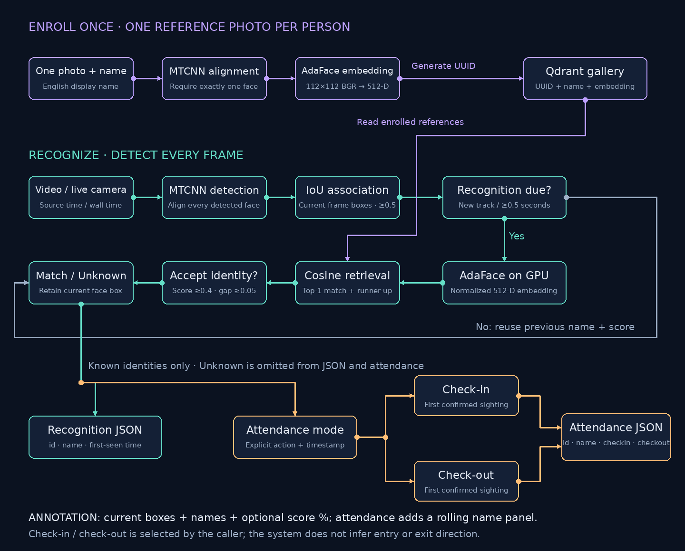
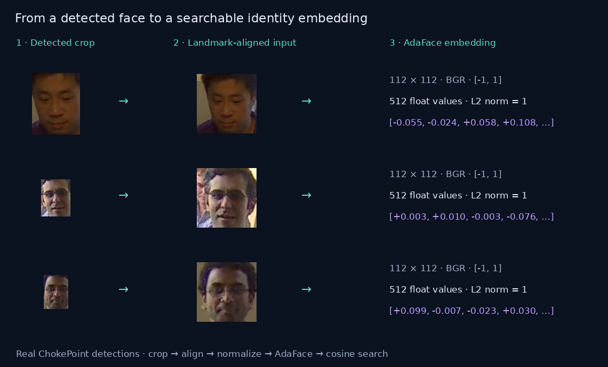

# Face Recognition & Attendance

Enroll someone from a single photograph, recognize them in a video or live
camera stream, and optionally record attendance. The project uses **AdaFace
embeddings**, **MTCNN face detection and alignment**, and **Qdrant cosine
search**, with one shared recognition pipeline for both entry points.

Built and tested with Python 3.12.15, PyTorch 2.5.1 + CUDA 12.4, and an NVIDIA
GTX 1660 Ti. The application focuses on inference and one-photo enrollment;
it does not train a face recognition model.

## Demo


**Check-in from 00:03 → Check-out from 00:28 → repeat.** The preview above
loops automatically in this README. Both clips are combined into one video,
so the player does not need to load a second file between check-in and check-out.

[Watch the full-quality looping video](https://bmaged23.github.io/face-recognition-attendance/docs/demo/)
· [Download the combined MP4](https://github.com/bmaged23/face-recognition-attendance/raw/refs/heads/main/docs/media/attendance-demo.mp4)

The full-quality player autoplays muted and repeats continuously. It has playback
controls; if your browser blocks autoplay, press Play. GitHub README pages support
the looping GIF preview, but do not execute an HTML video player with autoplay
and loop controls. These are prerecorded results, not a live inference session.

To view the same player locally after cloning:

```sh
python scripts/serve_demo.py
```

Open **http://localhost:8080/**. The combined demo and preview are included in
Git; source datasets, original output files, and model checkpoints remain excluded.

## Pipeline



[Open the static SVG](docs/media/pipeline.svg) for a scalable, accessible view.
Both diagrams are generated from the same layout by
`python scripts/build_pipeline_diagram.py`.

Enrollment accepts exactly one detected face, produces a normalized embedding,
and stores it with a generated UUID and English display name. Video and camera
workflows detect faces on every frame. IoU association reuses a previous name
and score while retaining the current frame's box; a new track or a scheduled
refresh triggers a fresh embedding and gallery search.

A fresh match must meet both the absolute similarity threshold and the gap
between the best and second-best identities. Unknown faces remain visible in
annotations but do not produce recognition or attendance records. Attendance
is an explicit `checkin` or `checkout` action; the program does not infer
movement direction or toggle a person's state from repeated sightings.

## AdaFace: model and preprocessing

[AdaFace: Quality Adaptive Margin for Face Recognition](https://arxiv.org/abs/2204.00964)
was presented by Minchul Kim, Anil K. Jain, and Xiaoming Liu at CVPR 2022.
Its training loss adjusts the classification margin using feature norm as a
proxy for image quality, changing the influence of easy and difficult samples.
See the [official implementation](https://github.com/mk-minchul/AdaFace).

This application loads the pretrained **WebFace12M R100 model**. The setting
`ir_100_webface12m` maps to upstream's `ir_101` backbone constructor. Detection
and alignment belong to MTCNN; AdaFace produces the identity embedding. The
training loss and classification head are not used during inference.

For both enrollment and recognition:

1. Decode the image and apply EXIF orientation where applicable.
2. Detect faces and use five landmarks to align each crop to **112 × 112**.
3. Convert the aligned RGB crop to **BGR**, normalize channels to `[-1, 1]`,
   and arrange the tensor as `N × 3 × 112 × 112`.
4. Run the pretrained backbone and normalize its **512-dimensional** embedding.
5. Compare against enrolled embeddings using cosine similarity.

### From cropped faces to the top-1 identity

These are **actual detections from the ChokePoint video**, followed by the
landmark-aligned crops that the AdaFace backbone consumes. Each face is
processed separately, even when several people appear in the same frame.



The bounding-box crop isolates the face. MTCNN's five landmarks then warp the
original image into an aligned 112 × 112 face; this is more precise than simply
resizing the rectangular crop. The aligned face is converted to a normalized
BGR tensor and passed through AdaFace to produce a 512-value embedding. The
embedding describes facial appearance for matching; it is not a name or a
picture stored in the attendance record.

During enrollment, that embedding is stored in Qdrant alongside the person's
UUID and name. During recognition, each new face embedding queries the same
gallery. **The highest cosine similarity is the top-1 candidate.** The system
assigns that person's name only when the score is at least `0.4` and, when
another identity exists, the top-1 score exceeds the runner-up by at least
`0.05`. The runner-up supports this ambiguity check; only the top-1 identity
can become the result. A rejected match is labeled `Unknown`.

For example, a top-1 score of `0.822` and top-2 score of `0.701` passes both
checks and is displayed as `82.2%`. Scores of `0.822` and `0.810` are too close,
so the face is `Unknown` despite the high top-1 score. These numbers illustrate
the matching rule; the image above contains real embedding values.

The crop/alignment examples are modified dataset derivatives, covered by the
[ChokePoint source notice](docs/licenses/SOURCE_AND_LICENSE.html). The script
`python scripts/datasets/build_face_examples.py` regenerates them from the
retained source video using the actual GPU backend.

The model and detector run on CUDA when `DEVICE=cuda`. The large training
checkpoint is loaded on CPU first; only its inference backbone is moved to
the GPU, avoiding GPU memory allocation for an unused classifier. Model
fingerprints prevent mixing incompatible reference embeddings.

The application's `RECOGNITION_MIN_MARGIN` is a separate **inference ambiguity
guard**. It is not AdaFace's quality-adaptive training margin. Annotated values
such as `82.2%` mean cosine similarity × 100, not a calibrated probability.

## Install and run from a fresh clone

The exact requirements reproduce the tested **Linux x86_64 / WSL2**,
**Python 3.12**, **CUDA 12.4 PyTorch** environment, including transitive,
API, test, and packaging dependencies. They are not a cross-platform lock for
macOS or native Windows. Use WSL2 on Windows. A compatible NVIDIA driver is
required for the documented GPU configuration; the tested driver was 560.76.
The PyTorch wheels include CUDA runtime libraries, so the CUDA development
toolkit and Windows SDKs are not required for inference.

### 1. Clone the project

Git must already be installed (`sudo apt-get install -y git` on Ubuntu).

```sh
git clone https://github.com/bmaged23/face-recognition-attendance.git
cd face-recognition-attendance
```

The necessary AdaFace inference source and small MTCNN weights are already
included under `vendor/adaface/`. **Do not install AdaFace's training
requirements or clone another copy into that folder.** Upstream provenance,
local changes, licenses, and an optional research-clone command are documented
in [vendor/README.md](vendor/README.md).

### 2. Install system prerequisites

Install FFmpeg and Python 3.12 with venv support. On Ubuntu 24.04:

```sh
sudo apt-get update
sudo apt-get install -y git curl ffmpeg libgl1 libglib2.0-0 python3.12 python3.12-venv
python3.12 --version
ffmpeg -version
nvidia-smi
```

FFmpeg converts annotated videos to browser-compatible H.264/yuv420p MP4 with
fast-start metadata. It is required when requesting `--annotated-video`.
Install Docker with the Compose plugin using the instructions for your host:

- **Windows/WSL2:** install Docker Desktop for Windows, start it, and enable
  Ubuntu under **Settings → Resources → WSL Integration**. Use its WSL2
  engine. See the [official WSL2 setup guide](https://docs.docker.com/desktop/features/wsl/).
- **Native Ubuntu:** follow the [official Docker Engine installation guide](https://docs.docker.com/engine/install/ubuntu/),
  including the Compose plugin and post-install permission setup. If your Docker
  commands require elevated privileges, use `sudo docker compose` in the later
  Compose examples.

Verify the daemon and plugin before proceeding:

```sh
docker compose version
docker info
```

For Ubuntu versions without Python 3.12 packages, install Python 3.12 separately
before the next step.

### 3. Create the virtual environment and install exact dependencies

```sh
python3.12 -m venv .venv
source .venv/bin/activate
python -m pip install -r requirements.txt
python -m pip check
```

`requirements.txt` pins every installed distribution to the exact `.venv`
version, including PyTorch's `+cu124` build. `requirements-dev.txt` includes the
same snapshot; there is no separate competing lockfile. The InsightFace
adapter is an experimental alternative with separate requirements and is not
part of the validated AdaFace environment.

### 4. Download and verify the AdaFace checkpoint

```sh
python scripts/download_model.py
python scripts/download_model.py --verify
```

The script downloads the tested checkpoint (~1.53 GB) from a revision-pinned
mirror and verifies SHA-256 before installing it. The
[official WebFace12M download](https://drive.google.com/file/d/1dswnavflETcnAuplZj1IOKKP0eM8ITgT/view)
is also available; the mirror was used because the official Drive download
exceeded its quota during setup.

Default destination:
`vendor/adaface/pretrained/adaface_ir100_webface12m.ckpt`.
The expected SHA-256 is
`0e7a3238d2a50f3fe3860782534928ac7cb2598977cf897f6869fd5ac2493fd0`.
To store it elsewhere, pass `--destination /path/to/model.ckpt` and set
`ADAFACE_MODEL_PATH` to that same absolute path in `.env`.

### 5. Configure GPU inference and start Qdrant

```sh
cp .env.example .env
docker compose up -d qdrant
curl --fail http://localhost:5333/healthz
python scripts/check_gpu.py
```

The provided configuration uses `DEVICE=cuda`. The GPU diagnostic checks CUDA,
the AdaFace architecture, and MTCNN; its random-weight test is not an accuracy
benchmark. Set `DEVICE=cpu` explicitly if you intend to run without a GPU.
Qdrant stores enrolled identities in a persistent Docker volume.

### 6. Add your inputs and enroll a person

Use a clear, upright photograph with exactly one face. One photograph is
sufficient; a sharp frontal image generally gives a better reference than a
small, blurred, or grayscale crop.

```sh
mkdir -p input/photos input/videos
# Copy your own photo to input/photos/alex.jpg and video to input/videos/checkin.mp4.
python enroll.py --name "Alex Morgan" --photo input/photos/alex.jpg
```

Enrollment prints `{"id": "generated-uuid", "name": "Alex Morgan"}`. Save the UUID
if you want to replace that person's reference with `--person-id UUID`.
Omitting `--person-id` creates a new identity, even if the name already exists.
National IDs and course-specific fields are not used.

### 7. Recognize a saved video

```sh
python video_recognition.py \
  --video input/videos/checkin.mp4 \
  --output output/recognition.json \
  --annotated-video output/recognition.mp4
```

Annotations show all detected faces, English names or `Unknown`, and optional
similarity percentages. Output MP4s contain no audio. Recognition JSON contains
each recognized person once per run, with their first confirmed sighting.

```json
[
  {"id": "generated-uuid", "name": "Alex Morgan", "time": "00:00:03.200"}
]
```

Without `--start-time`, video time is relative to the input. With an ISO 8601
start time including timezone, recognition uses absolute timestamps.

### 8. Record attendance, if needed

The threshold refers to **recognition similarity**, not the duration a person
appears in the video. Attendance records the first accepted sighting for the
selected action. Share one attendance file between the check-in and check-out
runs for a session/day. Set recording times to your actual capture times.

```sh
python video_recognition.py \
  --video input/videos/checkin.mp4 \
  --mode attendance --action checkin \
  --start-time "2026-10-12T09:00:00+03:00" \
  --attendance-file output/attendance/session.json \
  --output output/checkin.json \
  --annotated-video output/checkin.mp4

python video_recognition.py \
  --video input/videos/checkout.mp4 \
  --mode attendance --action checkout \
  --start-time "2026-10-12T17:00:00+03:00" \
  --attendance-file output/attendance/session.json \
  --output output/checkout.json \
  --annotated-video output/checkout.mp4
```

The shared attendance file contains only:

```json
[
  {
    "id": "generated-uuid",
    "name": "Alex Morgan",
    "checkin": "2026-10-12T09:00:03.200+03:00",
    "checkout": "2026-10-12T17:00:06.100+03:00"
  }
]
```

Unobserved actions are `null`. Repeated sightings do not toggle attendance.
Annotations add a left-side `Check-in` or `Check-out` heading and one black
rectangle per name. When the column fills, the oldest visible name scrolls
off; all attendance records remain in JSON. Per-run result files contain the
people observed in that run, while the shared attendance file accumulates both
actions across runs.

### 9. Use a live camera or RTSP stream

```sh
python live_camera_recognition.py --source 0 --display

python live_camera_recognition.py \
  --source 0 --display --mode attendance --action checkin \
  --attendance-file output/attendance/session.json

python live_camera_recognition.py --source "rtsp://YOUR_CAMERA_STREAM" --display
```

Press **Q** in the preview, or **Ctrl+C**, to stop. Live attendance uses the
current local timestamp with timezone. Camera permissions, WSL camera access,
and RTSP connectivity depend on your machine; they have not been verified in
the recorded video tests.

## Configuration

Settings are read from `.env` through `face_recognition/config.py`.

| Variable | Default in `.env.example` | Meaning |
|---|---|---|
| `MODEL_NAME` | `ir_100_webface12m` | Tested AdaFace WebFace12M model |
| `DEVICE` | `cuda` | `cuda`, `cpu`, or `auto` |
| `QDRANT_URL` | `http://localhost:5333` | Local database URL |
| `QDRANT_COLLECTION` | `people_adaface_ir_100_webface12m` | Shared enrollment and recognition gallery |
| `RECOGNITION_CONFIDENCE` | `0.4` | Minimum cosine similarity |
| `RECOGNITION_MIN_MARGIN` | `0.05` | Required top-1 minus top-2 score; `0` disables |
| `SHOW_RECOGNITION_CONFIDENCE` | `true` | Display scores as one-decimal percentages |
| `USE_IOU_TRACKING` | `true` | Associate current detections with the previous frame |
| `IOU_THRESHOLD` | `0.5` | Minimum box overlap for reuse |
| `RECOGNITION_REFRESH_SECONDS` | `0.5` | Maximum time between recognition refreshes |
| `SAMPLE_EVERY` | `0` | Use default tracking refresh; without tracking, recognize every frame |

A positive `--sample-every` overrides the recognition interval. With tracking,
detection still runs every frame. Without tracking, a positive interval samples
recognition and holds the last boxes between samples. For a full every-frame
recognition comparison, set `USE_IOU_TRACKING=false` and `SAMPLE_EVERY=0`.
When only one identity is enrolled, the absolute threshold applies without a
second-candidate margin. Tune thresholds against representative labeled data;
the provided values are a tested baseline, not a universal guarantee.

## API and Docker

The optional FastAPI service shares the same runtime and recognition engine:

```sh
uvicorn face_recognition.api.app:app --host 127.0.0.1 --port 7323
```

Open http://localhost:7323/docs for the request schemas. Routes:

| Method | Route | Purpose |
|---|---|---|
| `GET` | `/health` | Service liveness |
| `POST` | `/enroll` | Multipart photo, English name, optional existing UUID |
| `POST` | `/recognize/image` | Recognize faces in an uploaded image |
| `POST` | `/video-recognition` | Start a saved-video job in either mode |
| `GET` | `/jobs/{job_id}` | Read job status and result paths |

Video jobs take paths accessible to the server, not multipart video uploads.
Job metadata is held in memory; generated files persist. Live cameras use the
camera CLI. This API has no authentication and is intended for trusted/local
use. `/health` is a liveness check, not a model/database readiness test.

For the full GPU Docker stack, install the NVIDIA Container Toolkit or use
Docker Desktop with supported GPU/WSL integration, then run:

```sh
docker compose up --build -d
```

Compose mounts the checkpoint read-only, `input/` read-only, and `output/` for
results; Qdrant uses a named volume. `.dockerignore` excludes local data and
checkpoints from image builds. The Docker configuration is provided but has
not been validated end to end in this workspace.

## Project layout

```text
enroll.py                       Single-photo enrollment CLI
video_recognition.py            Saved-video entry point
live_camera_recognition.py      Live-camera/RTSP entry point
face_recognition/
  core/                         Detection, alignment, embeddings, matching
  enrollment/                   Single-face enrollment and reference replacement
  storage/                      Qdrant identities and atomic attendance JSON
  video/                        IoU reuse, stream processing, annotation, encoding
  api/                          HTTP routes, validation, background jobs
  config.py                     Shared validated settings
  runtime.py                    Backend/store construction
  cli.py                        CLI adapters
scripts/
  check_gpu.py                  GPU architecture and detector diagnostic
  download_model.py             Checkpoint download and checksum verification
  serve_demo.py                 Local looping playlist
  build_pipeline_diagram.py     SVG and animated GIF generator
  datasets/                     Optional dataset preparation/evaluation utilities
tests/                          Regression, API, media, matching, attendance tests
vendor/adaface/                 Pinned inference source, MTCNN weights, licenses
docs/                           Architecture, validation, evaluation, media, notices
requirements.txt                Exact .venv package versions
.env.example                    Shareable configuration template
Dockerfile / docker-compose.yml Optional API and Qdrant deployment
```

Local-only folders are ignored: `.venv/`, `.python/`, `.cache/`, `input/`,
`output/`, `archive/` (previous implementation), and `description/` (extended
working notes). The active application is independent of the archive. Private
photos, checkpoints, and generated outputs are not committed. Documentation
images and vendored small MTCNN `.npy` weights remain eligible for Git.

## Validation and evaluation

```sh
python -m unittest discover -s tests -v
python -m pip check
```

The 70 regression tests cover enrollment validation and IDs, cosine
threshold/margin behavior, tracking, API jobs, media encoding, timestamps, and
attendance state, and HTTP video-range requests. They verify software behavior,
not recognition accuracy.

Real GPU evaluation used one enrollment photo per person. On the labeled
ChokePoint camera-1 view, correct accepted matches increased from **129/135
(95.6%)** with small grayscale references to **134/135 (99.3%)** with color
stills. Both had zero wrong accepted identities in that sample.

These results are conditional on detected, labeled faces. Camera 1 and the
calibration camera 2 are different views of the **same S2 recording**;
90 camera-1 samples lacked a usable detector match. The crowded S5 demo has no
supplied identity ground truth, so it is a qualitative demonstration, not a
99.3% accuracy benchmark. IoU reuse can carry a mistaken identity between
refreshes, particularly when people cross. More accepted names do not by
themselves establish better accuracy.

See [validation and measured results](docs/VALIDATION.md),
[dataset utilities](scripts/datasets/README.md),
[architecture](docs/ARCHITECTURE.md), and [migration notes](docs/MIGRATION.md).
The original experiment reports are retained as evidence under
`docs/evaluation/`; disposable experiment outputs were cleaned up.

## Attribution

The pretrained recognition method and vendored model code come from
[AdaFace](https://github.com/mk-minchul/AdaFace), not from a model trained in
this project. AdaFace's MIT notice and the nested MTCNN license are retained.
Application work includes the shared workflows, identity storage, attendance
state, matching guard, tracking integration, annotation, and deployment tools.

The demo is a modified derivative of the
[NICTA ChokePoint dataset](https://arma.sourceforge.net/chokepoint/).
Names are aliases; attendance dates are synthetic. Dataset use is restricted
to noncommercial research and personal experimentation. See the original
[source and license notice](docs/licenses/SOURCE_AND_LICENSE.html) and
[modified-data notice](docs/licenses/MODIFIED_DATA_NOTICE.txt). The dataset's
notice requests citation of Wong et al., *Patch-based Probabilistic Image
Quality Assessment for Face Selection and Improved Video-based Face
Recognition*, CVPR Workshops, 2011. Dataset/video rights are separate from the
vendored code licenses.
