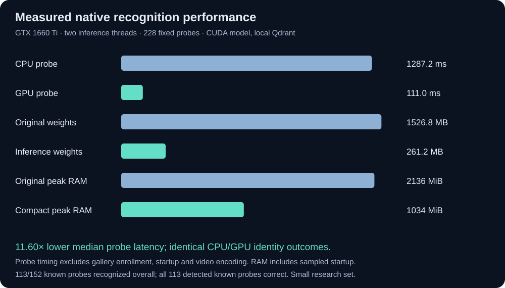

# Recognition and performance evaluation

The 26 October 2026 native study uses **228 frozen labeled probes**, **19 enrolled
identities**, and **10 different identities never enrolled**. Identity and eye
coordinates come from ChokePoint annotations. Enrollment uses one neutral still
per known person. Sampling selects four evenly spaced annotated frames per
identity/view before running any model. No failed detection is removed afterward.



## Native results

| Measure | CPU | CUDA |
| --- | ---: | ---: |
| Probe executions | 228/228 | 228/228 |
| Known probes detected / all known probes | 113/152 | 113/152 |
| Correct known identities / detected known probes | 113/113 | 113/113 |
| Known-person success including detector misses | 74.34% | 74.34% |
| Wrong known identities accepted | 0 | 0 |
| Unknown probes detected / all unknown probes | 56/76 | 56/76 |
| Unknown identities falsely accepted / detected unknown probes | 0/56 | 0/56 |
| Median detection + embedding + local search | 1,287.20 ms | 110.95 ms |
| p95 probe latency | 1,418.79 ms | 162.16 ms |

This is an **11.60× median probe latency ratio**, with identical detection and
identity decisions across CPU/GPU runs. It excludes initialization, enrollment,
video encoding and HTTP transport. It is not an application-wide speedup.
Hardware: GTX 1660 Ti 6 GiB, Python 3.12.15, Torch 2.5.1+cu124, two inference
threads, in-memory Qdrant, confidence 0.4, ambiguity margin 0.05.

The development view recognizes 70/76 known probes including detection misses;
the held-out camera view recognizes 43/76. The views share the same recording,
so this is **not independent-session validation**. Repeated frames are
correlated. The dominant accuracy weakness is detection, especially in camera 1.
Zero errors on a small exposed set does not imply a zero population error rate:
0/56 unknown false accepts has a Wilson 95% upper bound of about 6.4% if samples
were independent; their correlation further limits that interpretation.

## Compact checkpoint

The original training checkpoint is 1,526,801,999 bytes. Exporting only its
inference backbone produces 261,182,802 bytes, with **917 tensors exactly equal**.
All 228 outcomes and match scores were identical in the full/compact GPU runs.
Sampled peak process RSS fell from 2,135.55 to 1,034.34 MiB. Observed model loading
was 8.30 versus 1.92 seconds. Filesystem caches and sampling affect these values;
they are observations on this setup, not startup guarantees.

The compact file has a different fingerprint. Use a fresh gallery/re-enroll when
switching checkpoint files; the application rejects incompatible fingerprints.
[Export evidence](measurements/checkpoint-export.json).

## Rejected alternatives

A 0.707 scale pyramid plus final detector threshold 0.8 reduced development-view
median probe latency to 73.49 ms but accepted only 60/76 known probes, versus
70/76 for the original policy. It was rejected. Lowering only the final threshold
to 0.8 retained 70/76 known successes and detected one additional unknown probe,
but did not improve known-person coverage and was slower in that run. Defaults
remain factor 0.85 and final threshold 0.9. Both reports are retained below.

## Reproduce

Obtain `Still.tar.xz`, `P2E_S2.tar.xz`, and `groundtruth.tar.xz` from the official
[ChokePoint Zenodo record](https://zenodo.org/records/815657), placing them under
`input/chokepoint/`. The preparation script verifies the official MD5 checksums,
extracts only selected frames/stills, and records SHA256 for every fixture.

```sh
python scripts/evaluation/prepare_recognition_cases.py
OMP_NUM_THREADS=2 OPENBLAS_NUM_THREADS=2 python scripts/evaluation/evaluate_recognition.py \
  --device cuda --output output/evaluation/native-cuda.json
OMP_NUM_THREADS=2 OPENBLAS_NUM_THREADS=2 python scripts/evaluation/evaluate_recognition.py \
  --device cpu --output output/evaluation/native-cpu.json
python scripts/setup/export_inference_checkpoint.py
python scripts/evaluation/evaluate_recognition.py --device cuda \
  --model-path vendor/adaface/pretrained/adaface_ir100_webface12m.backbone.pt \
  --output output/evaluation/native-cuda-compact.json
```

The [frozen annotation manifest](../../evaluation/cases.json) contains sampling,
labels, relative filenames and content hashes, not images. The
[regression reference](../../evaluation/reference.json) records observed model
outcomes and release floors; **model predictions are not human ground truth**.
Do not regenerate references automatically during CI or use a model's top match
as the expected identity. The quality gate checks both human-label metrics and
unchanged regression outcomes. [Release process](../deployment/README.md).

## Scope and data terms

Real native HTTP smoke tests cover two photo enrollments, known recognition,
an unseen person, check-in/check-out video jobs, JSON/seekable-video downloads
and four-frame annotations. Repeated-frame clips are synthetic workflow tests,
not tracking accuracy ground truth. Offline tests use controlled inference but
real Qdrant, media and HTTP libraries. Camera/RTSP capture and behavioral fairness
are not established by these tests. Container qualification is recorded separately
when its exact-image gate completes; native measurements are not container scores.

ChokePoint is for noncommercial research/personal experimentation. Retain its
[source license](../licenses/SOURCE_AND_LICENSE.html),
[modified-data notice](../licenses/MODIFIED_DATA_NOTICE.txt), and citation:
Y. Wong, S. Chen, S. Mau, C. Sanderson, B.C. Lovell, “Patch-based Probabilistic
Image Quality Assessment for Face Selection and Improved Video-based Face
Recognition,” IEEE CVPR Workshops, 2011, pp. 81–88. Research fixtures and personal
galleries are excluded from the runtime image and from Git.

## Detailed reports

- [Native CPU](measurements/native-cpu.json)
- [Native CUDA](measurements/native-cuda.json)
- [Compact CUDA checkpoint](measurements/native-cuda-compact.json)
- [Rejected faster pyramid](measurements/dev-efficient-detector.json)
- [Threshold-only trial](measurements/dev-threshold-080.json)
- [Historical gallery calibration](calibration.json)
- [Historical crowded-video policy comparison](crowded_comparison.json)

Historical reports use different cohorts/protocols; do not combine their counts
with this new frozen study. [Original validation narrative](../VALIDATION.md).
